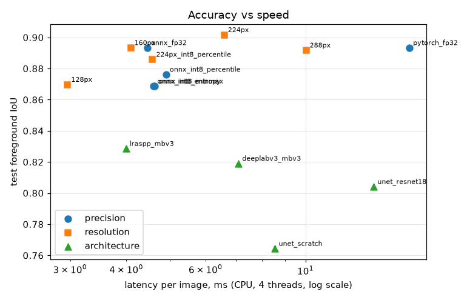

# Pet segmentation and background removal

An end-to-end computer vision project. A model finds the cat or dog in a photo
and separates it from the background, pixel by pixel. The result drives a
background-removal API and a small web app.

Data: [Oxford-IIIT Pet](https://www.robots.ox.ac.uk/~vgg/data/pets/) (7,349 images, 37 breeds, pixel-level trimaps).

| | |
|---|---|
| Task | Binary semantic segmentation (pet vs background) |
| Deployed model | LR-ASPP + MobileNetV3-Large (3.2M params), ONNX, 224 px input |
| Test foreground IoU | **0.902** (Dice 0.95) on the 3,669 official test images |
| Speed | 6.6 ms per image on a laptop CPU (PyTorch baseline: 17 ms) |
| Serving | FastAPI + ONNX Runtime on CPU, Docker image without PyTorch |
| Everything trained on | a laptop CPU (Ryzen 7 7730U), no GPU, no paid services |

Results, experiments and design decisions are in **[docs/REPORT.md](docs/REPORT.md)**.



### Results at a glance

| Experiment | Finding |
|---|---|
| 4 architectures | LR-ASPP/MobileNetV3 is the most accurate *and* fastest (test IoU 0.829 vs 0.819 DeepLabV3, 0.804 U-Net/ResNet-18, 0.764 U-Net from scratch) |
| Ablations | no ImageNet pretraining −16.6 IoU pts; CE-only −0.3; no augmentation ±0 (but overfits); **labelling the trimap border as pet +5.1** |
| Final model | border-as-pet on the full data: test IoU 0.829 → **0.893** |
| Optimisation | ONNX Runtime 3.8× faster than PyTorch with identical output; INT8 3.5× smaller (−1.6 pts); 224 px inference beats the 160 px training size (0.902) |
| Error analysis | weakest on small pets (0.73 when the pet is < 15% of the image); 7 of the 12 worst test cases are empty ground-truth masks |
How AI tools were used: [docs/AI_USAGE.md](docs/AI_USAGE.md).

## Quick start: run the demo

The trained models are in the repo, so the demo needs no training and no dataset:

| File | What | Size |
|---|---|---|
| `models/petseg.onnx` | deployed model, FP32, 224 px (default) | 12.9 MB |
| `models/petseg_int8.onnx` | INT8-quantised variant | 3.7 MB |
| `runs/final/best.pt` | PyTorch checkpoint of the same model | 13 MB |

Set `PETSEG_MODEL=models/petseg_int8.onnx` to serve the INT8 model instead.

```bash
python -m venv .venv
# Windows: .venv\Scripts\activate   macOS/Linux: source .venv/bin/activate
pip install -r requirements-serve.txt
uvicorn app.main:app --port 8000
```

Open http://localhost:8000, then drop in a photo or click a sample.

Command line, for a folder of your own photos:

```bash
python scripts/predict.py "photos/*.jpg" --out predictions/   # writes overlay, mask and cutout per image
```

Or with Docker:

```bash
docker build -t petseg .
docker run -p 8000:8000 petseg
```

### API

| Method | Path | Body | Returns |
|---|---|---|---|
| GET | `/health` | | model name, input size |
| POST | `/predict` | multipart `file` | JSON: pet area, bbox, timings, base64 PNGs of mask, overlay and cutout |
| POST | `/cutout?crop=true` | multipart `file` | `image/png`, the pet on a transparent background |

```bash
curl -F file=@my_dog.jpg http://localhost:8000/cutout -o my_dog_cutout.png
curl -F file=@my_dog.jpg http://localhost:8000/predict
```

Interactive docs: http://localhost:8000/docs.

### From Python

```python
from PIL import Image
from petseg.inference import Predictor

p = Predictor("models/petseg.onnx")      # or models/petseg_int8.onnx, runs/final/best.pt
r = p.predict(Image.open("cat.jpg"))
print(r.foreground_ratio, r.bbox(), r.latency_ms)
r.cutout().save("cat_cutout.png")
r.overlay().save("cat_overlay.png")
```

## Full pipeline: reproduce everything

```bash
pip install torch torchvision --index-url https://download.pytorch.org/whl/cpu   # or the CUDA build
pip install -r requirements.txt

python scripts/prepare_data.py --delete-archives   # download ~800 MB, keep a ~190 MB resized copy
python scripts/explore_data.py                     # dataset statistics -> results/eda.json, figures
python scripts/run_experiments.py                  # all 10 training runs -> runs/, results/experiments.md
python -m petseg.evaluate runs/final/best.pt       # test-set metrics + error analysis -> results/eval/final/
python scripts/optimization_study.py --deploy final  # ONNX export, INT8, resolution sweep -> results/optimization.md
python -m petseg.export runs/final/best.pt --out models/petseg --size 224 --calib percentile
pytest                                             # unit + API tests
```

One run: `python -m petseg.train configs/unet_resnet18.yaml [--epochs N --size 224 --limit 64]`.
Every config in `configs/` overrides a few keys of `configs/base.yaml`.

On a laptop CPU the full set of experiments takes about 5 hours. `notebooks/colab_train.ipynb`
runs the same on a free Colab GPU.

## Project structure

```
petseg/                 the library
  data.py               dataset, trimap -> label mapping, augmentations
  models.py             U-Net (scratch), U-Net/ResNet-18, LR-ASPP, DeepLabV3
  losses.py             cross-entropy, CE + soft Dice (with ignore pixels)
  metrics.py            confusion-matrix IoU / Dice / accuracy, per-image IoU
  train.py              training loop, checkpoints on best validation IoU
  evaluate.py           test-set evaluation + error analysis (per breed, size, worst cases)
  export.py             ONNX export + INT8 static quantisation
  benchmark.py          latency / size measurement
  inference.py          Predictor (PyTorch or ONNX) + cutout / overlay helpers
app/                    FastAPI service and web demo
scripts/                data preparation, EDA, experiment runner, optimisation study, CLI prediction
configs/                one YAML per experiment
models/                 exported ONNX models used by the app
runs/                   per-run history.csv + summary.json (and the final checkpoint)
results/                metrics, tables and figures quoted in the report
docs/                   technical report, AI-usage note
notebooks/              Colab notebook for GPU training
tests/                  pytest suite
```
